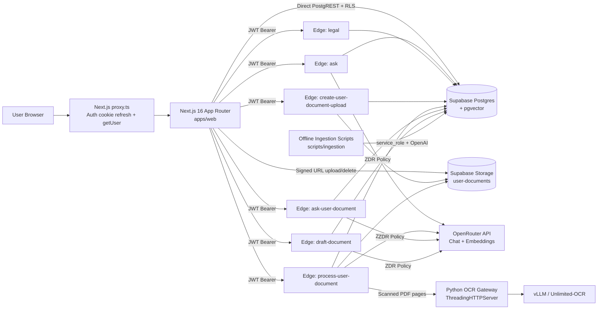

# LegalLens — Architecture Report

## 1. Technology Stack Inventory

| Layer | Technology | Evidence |
|---|---|---|
| **Frontend Framework** | Next.js `16.4.6` (App Router, Turbopack), React `19.2.4`, TypeScript `5.9.3` | `apps/web/package.json` |
| **Styling & Motion** | Tailwind CSS `3.4.19`, `motion` `14.14.0`, `three` `0.187.0`, `@react-three/fiber` `9.8.2`, `lucide-react` `1.35.0`, `@heroicons/react` `2.2.0` | `apps/web/package.json`, `tailwind.config.ts` |
| **Route Middleware** | Next.js 16 `proxy.ts` (`@supabase/ssr` `0.12.5`) | `apps/web/proxy.ts` |
| **Backend / API** | 6 Supabase Edge Functions (Deno runtime, `@supabase/supabase-js@2`). FastAPI backend was retired (`apps/api` removed; legacy `NEXT_PUBLIC_API_URL` fallback to `http://localhost:8000` still exists in `apps/web/next.config.js:12`). | `supabase/functions/*`, `apps/web/lib/api-client.ts:3-7` |
| **Database & Vectors** | Supabase PostgreSQL 16 + `pgvector` (`vector(1536)`), `pgcrypto`, Row Level Security (RLS), PL/pgSQL RPCs | `database/schema.sql`, `database/*_migration.sql` |
| **Auth & Storage** | Supabase Auth (Email/Password + Google OAuth PKCE; `jwt_expiry = 900s`, `inactivity_timeout = 1h`), Supabase Storage private bucket `user-documents` | `supabase/config.toml`, `apps/web/app/auth/*` |
| **AI Providers** | OpenRouter (`openai/gpt-4.1-mini`, `openai/text-embedding-3-small`, ZDR policy) in Edge Functions; OpenAI SDK (`text-embedding-3-small`) directly in offline ingestion scripts | `supabase/functions/_shared/openrouter.ts`, `scripts/ingestion/ingest-corpus.ts` |
| **OCR Sidecar Service** | Standalone Python 3.12 HTTP server (`ThreadingHTTPServer` + `PyMuPDF`) forwarding rendered PNGs to a vLLM endpoint (`baidu/Unlimited-OCR`) | `services/unlimited-ocr-gateway/gateway.py` |
| **CI/CD** | GitHub Actions (`web`, `edge-functions`, `document-pipeline-tests`, `ocr-gateway-tests`, `secret-scan` via Gitleaks, `schema` via `pgvector/pgvector:pg16`); Dependabot | `.github/workflows/ci.yml`, `.github/dependabot.yml` |
| **Deployment / IaC / Monitoring** | **None in repository.** `infrastructure/` and `packages/` are empty; no `vercel.json`, no Sentry/OpenTelemetry, no log drain. | Directory scan |

---

## 2. System Architecture & Request Flow

### Concrete Trace 1: "Ask a Legal Question"
1. **Frontend:** `apps/web/app/dashboard/ask/page.tsx:16-32` validates length (`>= 3`, `maxLength=2000`) and calls `askLegalQuestion(trimmedQuestion, response?.conversation_id)` in `apps/web/lib/api-client.ts:136-153`.
2. **Auth:** `api-client.ts:78-88` reads `session.access_token` from `supabase.auth.getSession()` and sends `POST ${NEXT_PUBLIC_SUPABASE_URL}/functions/v1/ask` with `Authorization: Bearer <token>` (no `apikey` header).
3. **Edge Entrypoint (`supabase/functions/ask/index.ts`):**
   - Validates JWT via `supabase.auth.getUser()` (lines 90-96).
   - Validates question length 3..2000 (lines 105-114).
   - Checks in-memory `RATE_LIMIT_BUCKETS` (20 req / 60s per isolate; lines 116-131).
   - Runs regex high-risk triage (`HIGH_RISK_PATTERNS`, lines 43-48, 135-147).
4. **Retrieval:** Calls `embedWithOpenRouter` (`openai/text-embedding-3-small`, 45s timeout) -> `supabase.rpc('match_document_chunks', { match_threshold: 0.72, match_count: 6 })` (lines 150-176). If empty (or embedding returned 429), falls back to `supabase.rpc('search_verified_document_chunks')` (lines 178-189).
5. **Generation & Citation Validation:** If chunks found, calls `generateWithOpenRouter` (`openai/gpt-4.1-mini`, `maxTokens: 1024`, default temperature) with `<source ref="UUID">` XML delimiters (lines 302-348). Extracts `[[cite:REF]]` tags and filters them deterministically against `retrievedIds` (lines 246-254).
6. **Persistence (BROKEN for Citations):** Calls `ensureConversation` -> `persistExchange` (lines 262-271, 356-416) using the **caller's anon/JWT client**. `messages` inserts succeed (errors ignored on user message), while `citations.insert` **silently fails RLS** because `public.citations` has no INSERT policy.

### Concrete Trace 2: "Private Document Upload & Processing"
1. **Frontend:** `apps/web/app/dashboard/documents/page.tsx:127-256` validates size (`<= 15 MB`), extension/MIME, and consent checkbox; calls `ensureConsent('private_document_processing')` (RPC `grant_consent`).
2. **Reservation:** Invokes `create-user-document-upload` (`index.ts:1-131`), which verifies JWT + server-side `checkConsent`, inserts a row into `user_documents` (trigger enforces 20-document quota with `pg_advisory_xact_lock`), and creates a signed upload URL via `service_role`.
3. **Upload:** Browser uploads file directly to Supabase Storage via `uploadToSignedUrl` (`documents/page.tsx:190-198`).
4. **Synchronous Processing:** Browser invokes `process-user-document` (`index.ts:1-448`), which verifies JWT + consent, atomically claims status `'uploaded'|'failed' -> 'processing'`, downloads bytes via `service_role`, checks magic bytes + size, parses PDF/DOCX/TXT, optionally calls `UNLIMITED_OCR_GATEWAY_URL` (300s timeout!), chunks pages (max 300 chunks / 900k chars), embeds ALL chunks in ONE OpenRouter call, inserts into `user_document_chunks`, and sets status `'ready'`.

---

## 3. Architectural Weaknesses, Bottlenecks & Dead Code

### Key Findings

#### `ARC-01` — Full Verified Corpus Loaded into Edge Memory on Every Search/Constitution Request + Silent 1,000-Row Truncation
- **Severity:** HIGH | **Category:** Architecture / Scalability | **Confidence:** High
- **Affected File:** `supabase/functions/legal/index.ts:67, 155-200`
- **Evidence:** `loadVerifiedCorpus()` queries `legal_source_versions` (`.limit(1000)`), `legal_sources` (`.limit(1000)`), `legal_sections` (`.limit(5000)`), and `document_chunks` (`.limit(10000)`) on EVERY `GET /functions/v1/legal` request, then loops through every chunk in JavaScript to filter by `mode=constitution` or substring terms. Meanwhile `scripts/ingestion/normalized-corpus/chunks/chunking-manifest.json` already contains **1,659 chunks**, exceeding PostgREST's default `max-rows` cap of `1,000`.
- **Reproduction:** Call `GET /functions/v1/legal?mode=search&q=traffic` when >1,000 chunks are verified in Postgres; inspect returned chunk count vs DB total, or fire 20 concurrent requests and observe DB egress/Edge memory spikes.
- **Impact:** Severe latency, Edge OOM crashes as corpus grows, unnecessary DB egress, and silent omission of legal provisions beyond PostgREST's row cap.
- **Likelihood:** High
- **Recommendation:** Replace `loadVerifiedCorpus()` with parameterized SQL/RPC full-text search (backed by a stored `tsvector` GIN index) and SQL-level filtering/pagination (`LIMIT`/`OFFSET` or cursor) for both `search` and `constitution` modes.

#### `ARC-02` — Synchronous Long-Running Document Processing & OCR Inside Edge Function Request Lifecycle
- **Severity:** LOW (reliability note) | **Category:** Architecture / Reliability | **Confidence:** High
- **Affected File:** `supabase/functions/process-user-document/index.ts:108-200, 358`
- **Evidence:** `process-user-document` performs PDF parsing, up to 10 pages of 300 DPI OCR (`AbortSignal.timeout(300_000)`), chunking, and embedding synchronously inside a single HTTP request. No queue, background worker, or stale-`'processing'` recovery timer exists.
- **Reproduction:** Upload a 10-page scanned PDF where OCR takes >150s (Supabase Edge wall-clock limit); Edge worker terminates, leaving `user_documents.processing_status = 'processing'` permanently (`claim` at line 113 only matches `['uploaded', 'failed']`).
- **Impact:** Documents permanently stuck in `'processing'` state; user cannot retry or ask questions without deleting and re-uploading.
- **Likelihood:** Medium
- **Recommendation:** Move extraction/OCR/embedding to an asynchronous job queue/worker (or Supabase Queues / background worker) with heartbeat timestamps and automatic stale-lock recovery (e.g. reset `'processing'` rows older than 5 minutes to `'failed'`).

#### `ARC-03` — Dead Code, Unused Components, Legacy FastAPI Residuals, and Uncleaned Repo Artifacts
- **Severity:** LOW | **Category:** Maintainability / Architecture | **Confidence:** High
- **Affected Files:**
  - Unused React components (0 external imports verified via case-sensitive grep): `apps/web/components/Button.tsx`, `Input.tsx`, `Toast.tsx`, `Navbar.tsx`, `MarginaliaRail.tsx`, `LoadingSpinner.tsx`.
  - Legacy FastAPI env reference: `apps/web/next.config.js:12` (`NEXT_PUBLIC_API_URL: process.env.NEXT_PUBLIC_API_URL || 'http://localhost:8000'`).
  - Unused constant: `EMBEDDING_BATCH_SIZE = 32` in `supabase/functions/process-user-document/index.ts:20`.
  - Orphan/duplicate repo artifacts: empty `infrastructure/` and `packages/`, `tests/unit/__pycache__/test_supabase_auth.cpython-312-pytest-9.1.1.pyc` (compiled bytecode with no source test), root `*.patch` files (`legalens-admin-and-ingestion-fix.patch`, `legalens-retire-fastapi.patch`), multiple superseded Police Act scripts (`chunk-police-act-v2.mjs`, `v4`, `reconstruct-police-act-v2.mjs`), and untracked `stage-1-docs/` & `LegalLens_Claude_Code_Starter_Kit/`.
- **Reproduction:** Inspect imports across `apps/web/app` and `apps/web/components`; list root directory.
- **Impact:** Increases cognitive load, misleads developers (e.g., `next.config.js` implies a localhost:8000 API still exists), and bloats maintenance surface.
- **Likelihood:** High
- **Recommendation:** Remove or archive unused components, orphan `.pyc` / `.patch` files, and the retired `NEXT_PUBLIC_API_URL` config entry.

### Single Points of Failure
1. **OpenRouter** (`supabase/functions/_shared/openrouter.ts`): Sole provider for both chat completions and embeddings; zero fallback provider and zero retry logic.
2. **Supabase Project** (Auth + Postgres + Storage + Edge Functions): Single cloud dependency; `proxy.ts` throws on missing env vars and calls `supabase.auth.getUser()` on every route hit (plus redundant calls in `dashboard/layout.tsx` and `admin/page.tsx`).
3. **Unlimited-OCR Gateway** (`services/unlimited-ocr-gateway/gateway.py`): Single-process Python `ThreadingHTTPServer` with no concurrency limit or health-checked autoscaling config.
