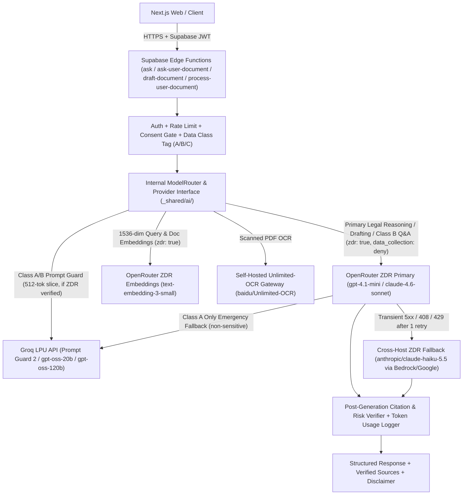

# LegalLens AI Provider and Model Strategy Audit

**Audit Date:** 2026-11-25  
**Scope:** Strictly read-only audit and architecture/strategy assessment of existing AI integrations, Groq, and OpenRouter. No application files, secrets, Edge Functions, database schemas, or packages were modified during this audit.  
**Related Architecture Docs:** [PROVIDER_MATRIX.md](file:///c:/Users/hp/Documents/legal_lens/docs/ai/PROVIDER_MATRIX.md), [RAG_AND_CITATIONS.md](file:///c:/Users/hp/Documents/legal_lens/docs/ai/RAG_AND_CITATIONS.md), [AI_ARCHITECTURE.md](file:///c:/Users/hp/Documents/legal_lens/docs/ai/AI_ARCHITECTURE.md)

---

## Executive Summary

- **CRITICAL Security Finding (`PROV-SEC-01`):** A live-formatted `OPENROUTER_API_KEY` is currently present in the tracked file [apps/web/.env.example](file:///c:/Users/hp/Documents/legal_lens/apps/web/.env.example) (line 5, modified in the local working tree and not yet committed to `HEAD`), and both `OPENROUTER_API_KEY` and `GROQ_API_KEY` exist in [apps/web/.env.local](file:///c:/Users/hp/Documents/legal_lens/apps/web/.env.local) (lines 9–10, untracked) inside the Next.js workspace even though Next.js client/server code does not invoke those providers. Both keys must be removed from `apps/web/` immediately, rotated at the provider consoles, and stored strictly in Supabase Edge Function secrets.
- **Current AI State:** LegalLens integrates **OpenRouter** (via Supabase Edge Functions), **OpenAI SDK directly** (in offline corpus ingestion), and a **self-hosted vLLM OCR gateway** (`baidu/Unlimited-OCR`). **Zero Groq integration** and **zero autonomous agents** exist in the codebase today.
- **OpenRouter SPOF & Account State:** Current Edge Function defaults (`openai/gpt-4.1-mini` and `openai/text-embedding-3-small`) each have only **1** Zero Data Retention (ZDR) endpoint on OpenRouter (Azure), creating a single-host bottleneck. Furthermore, the inspected OpenRouter key reports `is_free_tier: true`, `limit: null`, `limit_remaining: null`, `usage_daily: 0` — meaning no spend cap is configured and paid ZDR models cannot be served reliably without funded credits.
- **Groq Role:** Account access was verified at zero credit cost (`200 OK`, 11 active models including `openai/gpt-oss-120b`, `openai/gpt-oss-20b`, `qwen/qwen3.8-27b`, `openai/gpt-oss-safeguard-20b`, and `meta-llama/llama-prompt-guard-2-86m`/`22m`). Groq has **no embedding models and no rerankers**, and ZDR requires explicit opt-in in Groq Console Data Controls. Groq is well-suited for ultra-low-latency prompt-guard pre-filtering, query classification/rewriting, fast extraction, and Class A fallback — not embeddings, reranking, or unverified high-stakes legal reasoning.

---

## 1. Current AI Architecture

LegalLens currently splits AI execution across three disconnected paths without a unified `ModelProvider` abstraction:

1. **Online Runtime AI (Supabase Edge Functions):** Managed through [openrouter.ts](file:///c:/Users/hp/Documents/legal_lens/supabase/functions/_shared/openrouter.ts) and [openrouter-policy.mjs](file:///c:/Users/hp/Documents/legal_lens/supabase/functions/_shared/openrouter-policy.mjs). Used by four Edge Functions:
   - [ask/index.ts](file:///c:/Users/hp/Documents/legal_lens/supabase/functions/ask/index.ts) (Public Legal Q&A RAG)
   - [ask-user-document/index.ts](file:///c:/Users/hp/Documents/legal_lens/supabase/functions/ask-user-document/index.ts) (Private User Document Q&A RAG)
   - [draft-document/index.ts](file:///c:/Users/hp/Documents/legal_lens/supabase/functions/draft-document/index.ts) (Correspondence & Legal Drafting)
   - [process-user-document/index.ts](file:///c:/Users/hp/Documents/legal_lens/supabase/functions/process-user-document/index.ts) (User Document Chunking & Embedding)
2. **Offline Corpus Ingestion:** [ingest-corpus.ts](file:///c:/Users/hp/Documents/legal_lens/scripts/ingestion/ingest-corpus.ts) bypasses OpenRouter completely and calls the `openai` Node SDK directly.
3. **Self-Hosted Document OCR:** [gateway.py](file:///c:/Users/hp/Documents/legal_lens/services/unlimited-ocr-gateway/gateway.py) runs a Python `ThreadingHTTPServer` forwarding scanned PDF pages from `process-user-document` to a vLLM-compatible endpoint (`baidu/Unlimited-OCR`).

**Key Architectural Gaps Observed in Code:**
- **No `ModelProvider` Interface:** Calling code imports concrete `openrouter.ts` helpers directly; adding Groq, Anthropic, or Google Vertex requires refactoring callers unless wrapped behind a shared interface (as outlined in [AI_ARCHITECTURE.md](file:///c:/Users/hp/Documents/legal_lens/docs/ai/AI_ARCHITECTURE.md)).
- **Vector Schema Lock-In:** Both `document_chunks` and `user_document_chunks` vectors are locked to **1536 dimensions** (`openrouter.ts` enforces `embedding.length !== 1536`), with no `embedding_model` metadata column to allow safe mixed-model migrations or re-indexing.
- **Zero Token Telemetry:** `openrouter.ts` parses completion text/embeddings and discards the `usage` object (`prompt_tokens`, `completion_tokens`, `total_tokens`), leaving LegalLens blind to per-request cost and token budgets.
- **No Reranking Stage:** Neither `ask` nor `ask-user-document` uses a cross-encoder or LLM reranker; both take top-6 cosine matches directly.
- **Missing Consent Gate on `ask`:** `ask-user-document` (`privateDocuments`) and `draft-document` (`drafting`) enforce fail-closed consent checks via [consent.mjs](file:///c:/Users/hp/Documents/legal_lens/supabase/functions/_shared/consent.mjs) (`CONSENT_POLICY_VERSION = '2026-11-v1'`), whereas `ask/index.ts` has no consent gate.

---

## 2. Existing Provider Inventory

| Provider | Integration Surface | Purpose | Auth / Secret Location | Data Policy Enforcement |
| :--- | :--- | :--- | :--- | :--- |
| **OpenRouter** | `supabase/functions/_shared/openrouter.ts` & `openrouter-policy.mjs` | Chat completions + 1536-dim embeddings across 4 Edge Functions | `OPENROUTER_API_KEY` (Deno env; also dangerously present in `apps/web/.env.*`) | Hardcoded `PROVIDER_DATA_POLICY = { zdr: true, data_collection: 'deny' }` on all requests |
| **OpenAI (Direct SDK)** | `scripts/ingestion/ingest-corpus.ts` | Offline legal corpus embedding ingestion | `OPENAI_API_KEY` (script env) | Direct OpenAI API terms; no `zdr` / OpenRouter policy header |
| **Self-Hosted vLLM (`Unlimited-OCR`)** | `services/unlimited-ocr-gateway/gateway.py` | Scanned PDF OCR fallback (up to 10 pages/doc) | Local / internal service (`VLLM_BASE_URL`, optional token) | Controlled by LegalLens deployment host |
| **Groq** | **None (`0` references in application code)** | Not integrated | `GROQ_API_KEY` exists in `apps/web/.env.local` (unused) | N/A |

---

## 3. Existing Model Inventory

| Model Identifier | Provider | Where Used | Context / Params | Purpose |
| :--- | :--- | :--- | :--- | :--- |
| `openai/gpt-4.1-mini` | OpenRouter | `openrouter.ts` (`DEFAULT_MODEL` fallback for `ask`, `ask-user-document`, `draft-document`) | `maxTokens: 1024` (`ask`, `ask-user-document`), `1400` (`draft-document`); `temp: 0.1` / `0.2` | Legal Q&A, private doc Q&A, drafting |
| Env `OPENROUTER_FALLBACK_MODEL` | OpenRouter | `openrouter.ts` | Inherited per request | Optional fallback when primary model fails (unset by default) |
| `openai/text-embedding-3-small` | OpenRouter | `openrouter.ts` (`OPENROUTER_EMBEDDING_MODEL` fallback), used by `ask`, `ask-user-document`, `process-user-document` | Strictly validated `1536` dims; batch size `32` in `process-user-document` | Query & private document chunk embeddings |
| `text-embedding-3-small` | OpenAI Direct | `scripts/ingestion/ingest-corpus.ts` | `1536` dims (`MAX_CHUNK_CHARS = 6000`, `0` overlap) | Offline statutory/case corpus ingestion |
| `baidu/Unlimited-OCR` (default `VLLM_MODEL`) | vLLM HTTP Gateway | `services/unlimited-ocr-gateway/gateway.py` | `max_tokens: 8192`, `temperature: 0`, `120s` upstream timeout | Scanned PDF page OCR extraction |

---

## 4. Existing AI Workflows

| Workflow / File | Trigger & Rate Limit | Retrieval / Input Bounds | Generation Params & Safeguards | Current Weaknesses |
| :--- | :--- | :--- | :--- | :--- |
| **Public Legal Q&A** (`ask/index.ts`) | `ASK_RATE_LIMIT`: `20` req / `60s` (`rate-limit.mjs`) | `SIMILARITY_THRESHOLD = 0.72`, `MAX_CHUNKS = 6`, `MAX_CONTEXT_CHARS = 24_000` | `maxTokens: 1024`, `temperature: 0.1`, regex `HIGH_RISK_PATTERNS` | No `checkConsent` gate; no multi-turn history loaded into prompt; no semantic/deterministic citation verifier; no `usage` logging |
| **Private Doc Q&A** (`ask-user-document/index.ts`) | `DOC_ASK_RATE_LIMIT`: `20` req / `60s` | `SIMILARITY_THRESHOLD = 0.55`, `MAX_CHUNKS = 6` | `checkConsent(privateDocuments)` fail-closed (`403`/`503`); `maxTokens: 1024`, `temp: 0.1` | No reranker; single-shot retrieval; no citation verification against uploaded chunk text |
| **Document Drafting** (`draft-document/index.ts`) | `DRAFT_RATE_LIMIT`: `5` req / `60s` | `facts` length `30..4000` chars | `checkConsent(drafting)` fail-closed; `maxTokens: 1400`, `temp: 0.2`; post-guard rejects `draft.length > 8000` | No retrieval grounding for statutory references cited inside generated correspondence |
| **Document Processing** (`process-user-document/index.ts`) | `PROCESS_RATE_LIMIT`: `10` req / `60s` | `MAX_FILE_BYTES = 15MB`, `MAX_PDF_PAGES = 200`, `MAX_OCR_PAGES = 10`, `MAX_CHUNKS = 300`, `MAX_EXTRACTED_CHARACTERS = 900_000` | `EMBEDDING_BATCH_SIZE = 32`; OCR gateway timeout `300_000`ms; OpenRouter timeout `45_000`ms + 1 retry (`350`ms) | `MAX_OCR_PAGES = 10` truncates longer scanned legal PDFs; batch embed failure lacks partial retry checkpointing |
| **Corpus Ingestion** (`ingest-corpus.ts`) | Manual CLI script | `MAX_CHUNK_CHARS = 6000`, `0` overlap | Sequential single-chunk loop using `openai` SDK, no retry | Direct OpenAI dependency diverges from runtime OpenRouter embedder; no retry on rate limits; `0` chunk overlap risks boundary loss |

---

## 5. Groq Provider Assessment

**Verification Method:** Live zero-credit metadata check via `GET https://api.groq.com/openai/v1/models` returned `HTTP 200` with **11 active models** on the user's account. Paid inference, latency, Nigerian legal accuracy, and failure-injection behavior were **NOT TESTED** to comply with strict read-only audit constraints.

### 5.1 Live Account Model Inventory (`GET /openai/v1/models`)

| Model ID | Owner | Context Window | Max Completion Tokens | Primary Capability Fit | LegalLens Suitability |
| :--- | :--- | :--- | :--- | :--- | :--- |
| `openai/gpt-oss-120b` | OpenAI | `131,072` | `65,536` | General reasoning, tool calling, structured outputs | Strong fast fallback for Class A Q&A, query rewriting, structured extraction; unverified on Nigerian legal citations (`NOT TESTED`) |
| `openai/gpt-oss-20b` | OpenAI | `131,072` | `65,536` | Fast lightweight reasoning & extraction | Good for metadata tagging, fast intent routing, query expansion |
| `openai/gpt-oss-safeguard-20b` | OpenAI | `131,072` | `65,536` | Policy / safety classification | Suitable as a secondary safety/legal-advice-boundary classifier (`NOT TESTED`) |
| `qwen/qwen3.8-27b` | Alibaba Cloud | `131,072` | `16,384` | Multilingual & structured reasoning | Secondary alternative for extraction/classification (`NOT TESTED`) |
| `meta-llama/llama-prompt-guard-2-86m` | Meta | `512` | `512` | Prompt injection & jailbreak classification | High-value pre-filter for untrusted OCR text & user queries (`512`-token chunks) |
| `meta-llama/llama-prompt-guard-2-22m` | Meta | `512` | `512` | Ultra-fast prompt injection guard | Lower-latency alternative to `86m` guard model |
| `whisper-large-v3` | OpenAI | `448` | `448` | Speech-to-text transcription | Only needed if LegalLens adds voice intake / audio recordings |
| `whisper-large-v3-turbo` | OpenAI | `448` | `448` | Fast speech-to-text transcription | Only needed for future voice features |
| `canopylabs/orpheus-v1-english` | Canopy Labs | `4,000` | `50,000` | Text-to-speech (English) | Only needed for future audio accessibility features |
| `canopylabs/orpheus-arabic-saudi` | Canopy Labs | `4,000` | `50,000` | Text-to-speech (Arabic) | Not applicable to core Nigerian English legal workflows |
| `allam-2-7b` | SDAIA | `4,096` | `4,096` | Small Arabic/English LLM | Not recommended for Nigerian legal tasks |

### 5.2 Capability, Reliability, and Privacy Analysis

- **Strengths for LegalLens:**
  - **Ultra-low latency & high throughput** via Groq LPU hardware — ideal for pre-RAG gates (prompt-injection checks on `512`-token slices, query rewriting, intent/risk classification, fast JSON metadata extraction) and interactive Class A chat fallback.
  - **API compatibility:** OpenAI-compatible REST interface supporting tool calling and strict JSON Schema structured outputs (`json_schema`), easing integration behind a shared TypeScript provider adapter.
  - **No training on API data by default.**
- **Critical Limitations for LegalLens:**
  - **Zero Embedding Models & Zero Rerankers:** Groq cannot replace `openai/text-embedding-3-small` or supply a cross-encoder reranker.
  - **ZDR Requires Explicit Console Opt-In:** Unlike OpenRouter's per-request `provider: { zdr: true, data_collection: 'deny' }`, Groq Zero Data Retention must be explicitly enabled in Groq Console Data Controls (otherwise transient logging/abuse retention windows up to ~30 days may apply per vendor documentation). **Class B private user documents and Class C user PII MUST NOT be sent to Groq until ZDR opt-in is verified and documented on the account.**
  - **Narrow Reasoning Flagship Depth:** The account currently exposes `openai/gpt-oss-120b`, `openai/gpt-oss-20b`, and `qwen/qwen3.8-27b` (`131K` context), with no native Anthropic Claude, Gemini 1M-context, or GPT-4.1 frontier models. Fast inference does not equate to higher Nigerian statutory/case-law accuracy; Nigerian legal precision requires empirical evaluation before serving primary answers.

---

## 6. OpenRouter Provider Assessment

**Verification Method:** Live zero-credit checks against `GET https://openrouter.ai/api/v1/auth/key` and `GET https://openrouter.ai/api/v1/endpoints/zdr` returned `HTTP 200`.

### 6.1 Key & Account Status (`GET /api/v1/auth/key`)

- Response observed: `{"is_free_tier": true, "limit": null, "limit_remaining": null, "usage_daily": 0}`.
- **Audit Implications:**
  1. `limit: null` means **no hard API credit cap** is configured on the key. If credits are added later without setting a key limit, a denial-of-wallet bug or compromised secret could drain the balance.
  2. `is_free_tier: true` confirms the key has not been funded for paid tier usage; ZDR production endpoints (`openai/gpt-4.1-mini`, `anthropic/claude-*`, `openai/text-embedding-3-small`) require funded credits or BYOK.

### 6.2 ZDR Catalog & Pricing Verification (`GET /api/v1/endpoints/zdr`)

OpenRouter returned **`945` total ZDR endpoints** globally. Models relevant to LegalLens show the following verified ZDR coverage:

| Model ID | ZDR Endpoint Count | Verified ZDR Host(s) | Context Window | Verified Pricing (per 1M tokens) | Architectural Note |
| :--- | :--- | :--- | :--- | :--- | :--- |
| `openai/gpt-4.1-mini` *(current default)* | **`1`** | Azure (`openai/gpt-4.1-mini-2025-04-14`) | `1,047,576` | `$0.40` in / `$1.60` out | **Single-provider bottleneck** under strict `zdr: true` |
| `openai/gpt-4.1` | `3` *(family across nano/mini/4.1 on Azure)* | Azure | `1,047,576` | `$2.00` in / `$8.00` out (`nano`: `$0.10/$0.40`) | Higher-tier OpenAI reasoning option, still Azure-only for ZDR |
| `openai/gpt-4o-mini` | **`1`** | Azure | `128,000` | `$0.15` in / `$0.60` out | Cheaper OpenAI fallback, same Azure single-host risk |
| `anthropic/claude-4.6-sonnet` / `4.5-sonnet` | `4` | Amazon Bedrock, Google | `1,000,000` | `$3.00` in / `$15.00` out | Best ZDR diversity (2 independent hyperscalers) for complex legal reasoning/drafting |
| `anthropic/claude-haiku-5.5` | `4` | Google, Amazon Bedrock | `1,000,000` | `$0.10` in / `$0.50` out | Low-cost, high-resilience multi-host ZDR fallback |
| `google/gemini-2.5-pro-preview-06-05` | Multi-region | Google | `1,048,576` | `$1.25` in / `$10.00` out | Strong long-context (1M) synthesis & drafting option |
| `openai/gpt-oss-120b` | `22` | Fireworks (`$0.15/$0.60`), Parasail (`$0.15/$0.75`), Near AI (`$0.03/$0.15`), etc. | `131,072` | `$0.03–$0.15` in / `$0.15–$0.75` out | High ZDR provider redundancy on OpenRouter too |
| `openai/text-embedding-3-small` *(current embedder)* | **`1`** | Azure | `8,192` | `$0.02` in | **Single-host SPOF** for both ingestion & user doc search under `zdr: true` |

*Other ZDR Embedding Models Observed on OpenRouter (require 1536-dim compatibility check & full corpus re-indexing before adoption):* `openai/text-embedding-3-large`, `google/gemini-embedding-2`, `google/gemini-embedding-001`, `mistralai/mistral-embed-2312`, `mistralai/codestral-embed-2505`, `perplexity/pplx-embed-v2-context-0.6b`/`9b`, `perplexity/pplx-embed-v1-0.6b`/`4b`, `amazon/titan-embed-text-v1`/`v2`/`image-v1`, `qwen/qwen3-embedding-4b`/`8b`.

### 6.3 Gateway Suitability Verdict

OpenRouter already adds clear value to LegalLens by enforcing `provider: { zdr: true, data_collection: 'deny' }` per call and unifying billing/routing across Azure, AWS Bedrock, Google, and open-weight hosts without maintaining 5 separate SDK integrations. **However**, routing every request solely to single-host ZDR models (`openai/gpt-4.1-mini`, `openai/text-embedding-3-small` on Azure) creates an invisible availability SPOF unless `OPENROUTER_FALLBACK_MODEL` targets a different upstream hyperscaler (e.g., `anthropic/claude-haiku-5.5` on Google/Bedrock).

---

## 7. Provider Security Assessment

1. **CRITICAL — `PROV-SEC-01` Live-Formatted Secrets Inside Frontend Workspace:**
   - [apps/web/.env.example](file:///c:/Users/hp/Documents/legal_lens/apps/web/.env.example) (line 5, tracked file, currently dirty in the working tree) contains a live-formatted `OPENROUTER_API_KEY` value instead of a placeholder.
   - [apps/web/.env.local](file:///c:/Users/hp/Documents/legal_lens/apps/web/.env.local) (lines 9–10, untracked) holds both `OPENROUTER_API_KEY` and `GROQ_API_KEY`, even though Next.js does not call OpenRouter or Groq directly.
   - **Risk:** High risk of accidental commit to Git (`apps/web/.env.example`), local credential leakage, or exposure in frontend build environments.
   - **Required Action:** Replace the value in `apps/web/.env.example` with a placeholder (or remove the unused server key from `apps/web/.env.example`), delete both keys from `apps/web/.env.local`, **rotate both `OPENROUTER_API_KEY` and `GROQ_API_KEY` immediately**, and configure them exclusively via Supabase Edge Function secrets.
2. **Server-Side-Only Execution:** All AI keys (`OPENROUTER_API_KEY`, future `GROQ_API_KEY`, `OPENAI_API_KEY`) must only execute inside Supabase Edge Functions or offline CLI tools — never inside Next.js `NEXT_PUBLIC_*` variables or browser bundles.
3. **ZDR Enforcement & Fail-Closed Guarantee:** [openrouter-policy.mjs](file:///c:/Users/hp/Documents/legal_lens/supabase/functions/_shared/openrouter-policy.mjs) correctly injects `{ zdr: true, data_collection: 'deny' }` and fails closed on upstream `404`/routing errors (`describePolicyFailure`), preventing silent downgrade to non-ZDR hosts. **Do not override or relax this flag** when adding fallback logic.
4. **Prompt Injection Defense:** User-uploaded documents (`ask-user-document`, `process-user-document`) and raw queries (`ask`) are untrusted input vectors. Pre-screening untrusted text with `meta-llama/llama-prompt-guard-2-86m` (on Groq once ZDR is enabled, or strict delimiter/instruction-hierarchy isolation) reduces indirect prompt injection risk from hostile uploaded PDFs.
5. **NDPA & Nigerian Legal Confidentiality:** Per [PROVIDER_MATRIX.md](file:///c:/Users/hp/Documents/legal_lens/docs/ai/PROVIDER_MATRIX.md), Class B (Private User Documents) and Class C (User PII / facts) demand verified ZDR (`zdr: true` + zero prompt/response persistence in application logs) and formal review by Nigerian NDPA privacy counsel prior to production launch with real client files.
6. **Consent Enforcement Gap:** `ask/index.ts` lacks a `checkConsent` check; any multi-provider expansion should align all user-facing AI endpoints with explicit versioned consent (`CONSENT_POLICY_VERSION`).

---

## 8. Model-to-Task Mapping

*All quality ratings for Nigerian law are provisional and must pass empirical ground-truth evaluation (`NOT TESTED`) before promotion.*

| LegalLens Task | Recommended Provider | Recommended Model | Reason | Alternative | Risk |
| :--- | :--- | :--- | :--- | :--- | :--- |
| **Public Legal Q&A (RAG synthesis)** | OpenRouter (ZDR) | `openai/gpt-4.1-mini` | `1M` context, low temp (`0.1`), proven cost/quality balance (`$0.40/$1.60`) | `anthropic/claude-haiku-5.5` (OpenRouter, Bedrock/Google ZDR) or `openai/gpt-oss-120b` (Groq, Class A only) | Single ZDR host (`Azure`) for `gpt-4.1-mini`; Nigerian statutory hallucination if unverified (`NOT TESTED`) |
| **Complex Legal Reasoning / Scenario Analysis** | OpenRouter (ZDR) | `anthropic/claude-4.6-sonnet` *(or `4.5-sonnet`)* | Frontier multi-step reasoning + 4 ZDR endpoints across Bedrock & Google (`1M` ctx) | `openai/gpt-4.1` or `google/gemini-2.5-pro-preview-06-05` (OpenRouter ZDR) | Higher token cost (`$3.00/$15.00`); `NOT TESTED` on Nigerian appellate/statute nuances |
| **Legal Correspondence / Document Drafting** | OpenRouter (ZDR) | `anthropic/claude-4.6-sonnet` | Strong structured tone, instruction adherence, multi-host ZDR resilience | `openai/gpt-4.1-mini` (budget tier) | Unauthorized practice of law / fabricated statutory citations if post-check missing |
| **Private User Document Q&A (Class B)** | OpenRouter (ZDR) | `openai/gpt-4.1-mini` | Strict per-request `{ zdr: true, data_collection: 'deny' }` isolation | `anthropic/claude-haiku-5.5` (OpenRouter ZDR) | Must NEVER route to non-ZDR providers; chunk retrieval cutoff (`threshold 0.55`, `6` chunks) may miss context |
| **Large Document Summarisation (>100k tokens)** | OpenRouter (ZDR) | `google/gemini-2.5-pro-preview-06-05` | `1,048,576` context window on Google ZDR at `$1.25/$10.00` | `anthropic/claude-4.6-sonnet` (`1M` ctx) | Long-context "lost in the middle" degradation on dense contracts |
| **Query Rewriting & Intent / Area Classification** | Groq (or OpenRouter) | `openai/gpt-oss-20b` (Groq) | Ultra-low LPU latency (`131K` ctx) keeps pre-retrieval overhead minimal | `anthropic/claude-haiku-5.5` (OpenRouter ZDR, `$0.10/$0.50`) | Send Class A sanitized query only unless Groq account ZDR opt-in is verified |
| **Structured Legal Metadata / JSON Extraction** | Groq | `openai/gpt-oss-20b` / `openai/gpt-oss-120b` | Supports strict JSON Schema structured outputs + ultra-fast batch speed | `openai/gpt-4.1-nano` (OpenRouter Azure ZDR, `$0.10/$0.40`) | Schema rigidity; requires Groq ZDR opt-in for Class B private document chunks |
| **Prompt Injection & Safety Pre-Filter** | Groq | `meta-llama/llama-prompt-guard-2-86m` | Dedicated `512`-token injection/jailbreak classifier; negligible latency | `openai/gpt-oss-safeguard-20b` (Groq) or `meta-llama/llama-prompt-guard-2-22m` | Short `512`-token window requires sliding-window chunking on uploaded document text |
| **Embeddings (Online + Offline Corpus)** | OpenRouter (ZDR) | `openai/text-embedding-3-small` | Matches locked `1536`-dim schema in `document_chunks` & `user_document_chunks` (`$0.02/M`) | Direct OpenAI `text-embedding-3-small` (offline Class A ingestion only) | **1 ZDR host (Azure)** SPOF; changing model requires full vector re-indexing |
| **Chunk Reranking** | OpenRouter (ZDR) or Dedicated Reranker | `anthropic/claude-haiku-5.5` *(listwise ZDR fallback until dedicated reranker added)* | Groq & OpenRouter currently lack dedicated Cohere/BGE reranker endpoints verified under ZDR | `openai/gpt-4.1-nano` (OpenRouter ZDR) | LLM listwise reranking adds ~`200–500ms` latency; evaluate cost vs retrieval gain |
| **Scanned PDF OCR** | Self-Hosted vLLM | `baidu/Unlimited-OCR` (via `gateway.py`) | Existing `ThreadingHTTPServer` pipeline keeps Class B scans inside controlled infra | Cloud ZDR vision model (`NOT TESTED`) | `MAX_OCR_PAGES = 10` truncates longer scanned legal documents |
| **Claim-to-Citation Verification (Post-Check)** | Deterministic + OpenRouter/Groq | Regex/Substring Check + `openai/gpt-oss-120b` *(or `claude-haiku-5.5`)* | Verifies cited sections/cases actually appear in retrieved chunks before returning response | Pure deterministic string/ID verification (zero LLM cost) | False negatives if citations are paraphrased; must fail safe with "unverified citation" warning |
| **Agentic Multi-Step Research (Future Bounded)** | OpenRouter (ZDR) | `anthropic/claude-4.6-sonnet` (Planner) + `openai/gpt-oss-20b` (Sub-queries) | Strong tool-calling + multi-host ZDR resilience | Single-pipeline multi-query RAG (no autonomous loop) | Latency spikes, token runaway, and multi-step hallucination amplification |

---

## 9. Proposed Multi-Provider Strategy & Architecture Diagram

Adopt the strangler pattern documented in [AI_ARCHITECTURE.md](file:///c:/Users/hp/Documents/legal_lens/docs/ai/AI_ARCHITECTURE.md) using a **minimal, dependency-free TypeScript `ModelProvider` interface** inside `supabase/functions/_shared/ai/` (avoiding heavy frameworks like LangChain/LlamaIndex in Edge Functions to preserve cold-start speed and inspectability).

- **Role Separation:**
  - **OpenRouter (ZDR-locked)** = Primary reasoning, Class B private document Q&A, correspondence drafting, multi-hyperscaler fallback (`Azure`, `Bedrock`, `Google`), and `1536`-dim embeddings.
  - **Groq** = Ultra-fast Class A edge intelligence (prompt-injection pre-filter, query rewriting, area/risk classification, batch structured extraction, fast Class A fallback) — gated by `GROQ_ZDR_CONFIRMED` flag for Class B/C data.
  - **Self-Hosted vLLM** = OCR extraction (`gateway.py`).

---

## 10. Model Routing Recommendations

Route every request declaratively using a static policy table (`routePolicy(task, dataClass, contextTokens)`) rather than LLM-based meta-routing:

1. **Data Class Gate (Hard Security Boundary):**
   - **Class A (Public Nigerian statutes/cases & sanitized queries):** Eligible for OpenRouter ZDR and Groq.
   - **Class B (Private user uploads) & Class C (User PII/facts):** Allowed ONLY on providers with verified ZDR (`OpenRouter` with `{ zdr: true, data_collection: 'deny' }`; `Groq` ONLY after `GROQ_ZDR_CONFIRMED=true` is validated in console settings). Never log raw prompts/completions for Class B/C.
   - **Class D (Secrets/auth/tokens):** Never sent to any AI provider.
2. **Complexity & Context Length:**
   - Queries `< 24k` context chars with `>= 3` high-similarity corpus chunks (`>= 0.72`) route to `openai/gpt-4.1-mini` (`$0.40/$1.60`).
   - Complex drafting (`draft-document`), conflicting authorities, or requests requiring structured multi-factor scenario comparison escalate to `anthropic/claude-4.6-sonnet` (`$3.00/$15.00`).
   - Summarisation/analysis exceeding `128k` tokens routes to `google/gemini-2.5-pro-preview-06-05` or `anthropic/claude-4.6-sonnet` (`1M` ctx), never Groq (`131K` max).
3. **Structured Output & Tool Calling:**
   - Both Groq (`gpt-oss-20b`/`120b`, `qwen3.8-27b`) and OpenRouter (`gpt-4.1-mini`, `claude-4.6-sonnet`) support strict JSON Schema / tool calling; enforce strict Zod/schema validation in Edge Function TypeScript code regardless of provider `json_schema` flags.
4. **Offline / Runtime Embedding Parity:**
   - Route both `ingest-corpus.ts` and `openrouter.ts` embeddings through the same canonical `text-embedding-3-small` (`1536`-dim) configuration and add an `embedding_model` column before ever testing alternative ZDR embedders (`gemini-embedding-001`, `mistral-embed-2312`, etc.).

---

## 11. Fallback Recommendations

1. **Keep Fail-Closed ZDR Invariant:** Never fall back from a ZDR endpoint to a non-ZDR endpoint or strip `provider: { zdr: true, data_collection: 'deny' }`.
2. **Cap Retry + Fallback Blast Radius:** Limit every request to **at most 1 short retry (`350ms`)** on transient `5xx`/`408`/network errors on the primary provider, followed by **at most 1 cross-hyperscaler fallback** to avoid timeout cascades inside Edge Function execution limits.
3. **Fix Single-Host OpenRouter Vulnerability:** Because `openai/gpt-4.1-mini` has only **1 ZDR host (Azure)**, set `OPENROUTER_FALLBACK_MODEL` to a non-Azure multi-host ZDR model (`anthropic/claude-haiku-5.5` — hosted on Google & Amazon Bedrock) rather than another Azure-hosted OpenAI model.
4. **Error Classification:**
   - *Retryable / Fallback-eligible:* `HTTP 408`, `429`, `500`, `502`, `503`, `504`, `AbortError` timeout, or OpenRouter `404` "No endpoints found matching your data policy" (fallback to alternate ZDR model).
   - *Non-retryable (fail fast):* `HTTP 400` bad request / context length exceeded, `401`/`403` invalid API key or exhausted credit quota, `403` consent denied.
5. **Degraded-Mode UX:** If both primary and fallback providers fail on `ask` or `ask-user-document`, return a structured `503` response that still preserves deterministic retrieved source passages where safe, instead of an opaque error.

---

## 12. AI-Assisted Workflow Recommendations

**Agent Verdict:** LegalLens currently has **zero** autonomous agents, and **most LegalLens workflows should remain deterministic, bounded pipelines rather than autonomous ReAct/agent loops**. Autonomous loops increase latency, non-determinism, token burn, and prompt-injection attack surface in legal domains where citation accuracy matters more than open-ended planning.

| Workflow | Recommended Execution Pattern | Agentic? | Key Improvement |
| :--- | :--- | :--- | :--- |
| **Legal Assistant (`ask`)** | Multi-turn bounded pipeline: Prompt Guard (`Groq`) -> Query Rewrite + History Condense (`gpt-oss-20b`) -> Vector + FTS Hybrid Retrieval -> Rerank -> Single Grounded Synthesis (`gpt-4.1-mini`) -> Deterministic Citation Check | **No** (deterministic DAG) | Load recent `messages` history into prompt + add `checkConsent` + verify cited statutes exist in returned `sources` |
| **Legal Research** | Bounded 2-step research pipeline (max 2 sub-queries): Query Decomposer (`gpt-oss-20b`) -> Parallel Corpus Search -> Cross-document Synthesis (`claude-4.6-sonnet`) -> Citation Verifier | **Bounded max-2-step workflow** (not open-ended agent) | Explicit step cap (`maxSteps = 2`), per-step timeout, mandatory primary-source ground-truth check |
| **Document Intelligence (`process-user-document` + `ask-user-document`)** | OCR (`gateway.py`) -> Prompt-Guard Scan per chunk -> Sliding-window chunking with overlap -> Batch `1536`-dim Embed -> Summarisation / Q&A (`gpt-4.1-mini` or `gemini-2.5-pro`) | **No** | Raise or paginate `MAX_OCR_PAGES = 10` restriction; add `embedding_model` column; add overlap to chunker (`ingest-corpus.ts` & runtime) |
| **Scenario Analysis** | Structured dual-pass pipeline: Issue & Fact Extraction Schema (`gpt-oss-120b` / `haiku-5.5`) -> Legal Framework Retrieval -> Grounded Pros/Risks Matrix (`claude-4.6-sonnet`) | **No** | Strict disclaimer + deterministic missing-facts prompt before generating analysis |
| **AI Agents (Where Actually Justified)** | Only for multi-document case-file cross-referencing or multi-jurisdiction statutory comparison **with tool budget (`<= 4` tool calls), read-only retrieval tools only, and mandatory citation verification gate** | **Optional / Deferred (Phase 4)** | Gate behind feature flag, strict token ceiling, and automated benchmark pass before release |

---

## 13. Cost-Management & Denial-of-Wallet Recommendations

1. **Fix OpenRouter Unbounded Key (`limit: null`):** Immediately configure hard daily/monthly spend caps on the OpenRouter API key (and on any future Groq key) before adding production credits.
2. **Capture & Persist Token Usage:** Update `openrouter.ts` (and the unified provider client) to extract `usage.prompt_tokens` and `usage.completion_tokens`, persisting aggregate daily/monthly counts per `user_id`, `feature`, `provider`, and `model`.
3. **Add Token Budgets Alongside Request Rate Limits:** Current rate limits (`20 req/min` on `ask` / `ask-user-document`, `5 req/min` on `draft-document`, `10 req/min` on `process-user-document`) do not prevent a user from sending max-size (`24,000`-char context / `300`-chunk embed) requests continuously. Enforce daily token/character quotas per user tier.
4. **Tiered Routing & Pre-Filters:** Reject prompt-injection/off-topic requests cheaply with Groq `llama-prompt-guard-2-86m` or deterministic regex/length validation before invoking `claude-4.6-sonnet` or `gpt-4.1-mini`.
5. **Corpus Ingestion Batching & Retry:** Refactor `ingest-corpus.ts` from 1 chunk per HTTP request to batched embeddings (matching `EMBEDDING_BATCH_SIZE = 32`) with exponential backoff.

---

## 14. Privacy & Confidentiality Considerations

1. **ZDR Parity Across Providers:**
   - **OpenRouter:** Already enforces `provider: { zdr: true, data_collection: 'deny' }`. Note that upstream hosts may still apply automated abuse/safety edge rules unless enterprise DPA/BAA overrides apply; verify OpenRouter's current ZDR endpoint guarantees for chosen hosts (`Azure`, `AWS Bedrock`, `Google`).
   - **Groq:** Does **not** enforce per-request ZDR via header/body parameter in the same way as OpenRouter. Account-level **Zero Data Retention must be explicitly toggled ON** in Groq Console before any Class B/C data touches Groq, and verification must be logged as a deployment gate.
2. **Application-Side Zero-Logging Rule:** Ensure Supabase Edge Function logs, error reporters, and analytics tables **never** store raw prompt bodies, uploaded user document chunks, or user `facts` for Class B/C requests — log only request IDs, hashed user IDs, token counts, latency, and error codes.
3. **NDPA Compliance Review:** Engage qualified Nigerian data protection counsel to review cross-border subprocessor transfers (OpenRouter + Azure/Bedrock/Google US/EU endpoints, and Groq if ZDR-enabled) against Nigeria Data Protection Act (NDPA) requirements and update user privacy notices & `CONSENT_POLICY_VERSION` accordingly.

---

## 15. Integration Risks & Provider Testing Matrix

*Note: Zero-credit metadata/catalog checks ran during this audit (`GET https://api.groq.com/openai/v1/models` -> `200`, `11` models; `GET https://openrouter.ai/api/v1/auth/key` -> `200`; `GET https://openrouter.ai/api/v1/endpoints/zdr` -> `200`, `945` endpoints). Paid inference, rate-limit exhaustion, and failure-injection scenarios were **NOT TESTED** per read-only audit rules.*

| Test ID | Scenario | Target Scope | Verification Status | Expected / Pass Criteria When Executed |
| :--- | :--- | :--- | :--- | :--- |
| `PROV-01` | Groq account model availability check | `GET /openai/v1/models` | **PASS (Zero-Credit)** | `200 OK`, returns 11 active models |
| `PROV-02` | OpenRouter key & ZDR catalog inspection | `GET /api/v1/auth/key`, `/endpoints/zdr` | **PASS (Zero-Credit)** | `200 OK`, 945 ZDR endpoints confirmed; `limit: null` defect caught |
| `PROV-03` | Live Nigerian legal QA accuracy benchmark (`gpt-4.1-mini` vs `claude-4.6-sonnet` vs `gpt-oss-120b`) | `ask` golden question set | **NOT TESTED** | Zero fabricated statutes/cases; `>= 95%` citation match |
| `PROV-04` | Groq structured JSON Schema compliance under load | `gpt-oss-20b`, `gpt-oss-120b` | **NOT TESTED** | 100% Zod schema validation pass across 50 test inputs |
| `PROV-05` | OpenRouter ZDR fail-closed verification | Invalid/non-ZDR model forced with `zdr: true` | **NOT TESTED (Runtime)** *(unit-tested in `openrouter-policy` only)* | Fails closed with `describePolicyFailure`, never falls back to non-ZDR |
| `PROV-06` | Azure ZDR outage simulated fallback | `gpt-4.1-mini` timeout/503 -> `claude-haiku-5.5` | **NOT TESTED** | Clean fallback within Edge timeout, telemetry logged |
| `PROV-07` | Embedding outage graceful degradation | `text-embedding-3-small` 503 | **NOT TESTED** | Clean 503/FTS fallback on `ask`; no partial/corrupt chunks committed in `process-user-document` |
| `PROV-08` | Groq rate-limit (`429`) burst handling | Parallel query rewrite / prompt guard burst | **NOT TESTED** | Bounded retry/fallback without cascading request failure |
| `PROV-09` | Indirect prompt injection inside uploaded PDF | Malicious instruction inside Class B PDF | **NOT TESTED** | Prompt Guard / delimiter boundary blocks instruction hijacking |
| `PROV-10` | Groq Data Controls ZDR verification | Groq Console setting audit | **NOT TESTED (Account Admin Check)** | Explicit ZDR opt-in confirmed prior to Class B routing |
| `PROV-11` | Token usage capture & daily user quota cutoff | `openrouter.ts` + DB token ledger | **NOT TESTED** | Daily budget exceeded returns structured `429` before AI call |
| `PROV-12` | Multi-turn conversation history context preservation | `ask` follow-up queries | **NOT TESTED** | Follow-up pronouns resolve accurately to prior statutory turn |
| `PROV-13` | `apps/web/.env.*` secret remediation verification | Git diff & secret scan + key rotation | **NOT TESTED (Awaiting User Approval)** | Zero live keys in `apps/web/`; rotated keys return `401` on old tokens |

---

## 16. Prioritised Implementation Roadmap

| Phase | Priority | Deliverables | Exit Criteria |
| :--- | :--- | :--- | :--- |
| **Phase 0: Immediate Secret & Account Hygiene** *(Pre-Integration)* | **P0 (Critical)** | 1. Remove live keys from [apps/web/.env.example](file:///c:/Users/hp/Documents/legal_lens/apps/web/.env.example) and [apps/web/.env.local](file:///c:/Users/hp/Documents/legal_lens/apps/web/.env.local). 2. Rotate both `OPENROUTER_API_KEY` and `GROQ_API_KEY`. 3. Set explicit OpenRouter key spend `limit` (fund paid tier for ZDR). 4. Verify/enable ZDR opt-in in Groq Console. | Old keys invalidated (`401`), zero secrets in `apps/web/`, spend limit != `null`. |
| **Phase 1: Security, Telemetry & Resilience Fixes** | **P1 (High)** | 1. Add `checkConsent` gate to `ask/index.ts`. 2. Configure `OPENROUTER_FALLBACK_MODEL=anthropic/claude-haiku-5.5` (non-Azure ZDR fallback). 3. Extract & log `usage` tokens per request + enforce daily per-user token budgets. 4. Add `embedding_model` metadata column and chunk overlap. | `ask` consent-gated, single-host Azure failure triggers Bedrock/Google fallback, token ledger populated. |
| **Phase 2: Unified `ModelProvider` + Groq Pre-RAG & Retrieval Upgrades** | **P1/P2** | 1. Implement `supabase/functions/_shared/ai/` `ModelProvider` interface (OpenRouter + Groq adapters). 2. Add Groq `llama-prompt-guard-2-86m` pre-filter on untrusted queries/chunks. 3. Add Groq `gpt-oss-20b` Class A query rewriting + multi-turn history loading in `ask`. 4. Add deterministic citation verifier post-generation. | Provider swap controlled via config; citations verified against retrieved chunks; prompt-injection tests pass. |
| **Phase 3: Ground-Truth Legal Evaluation & Tiered Routing** | **P2** | 1. Build golden Nigerian legal QA & drafting eval suite (statutes, case citations, refusal triggers). 2. Benchmark `gpt-4.1-mini`, `claude-4.6-sonnet`, `gemini-2.5-pro`, and `gpt-oss-120b`. 3. Enable task-based routing (standard Q&A -> `gpt-4.1-mini`; complex drafting/scenarios -> `claude-4.6-sonnet`; >128k docs -> `gemini-2.5-pro`). 4. Raise/paginate `MAX_OCR_PAGES` & unify `ingest-corpus.ts` batching. | `>= 95%` citation accuracy on golden set; <1% false legal assertions; latency & cost SLAs met. |
| **Phase 4: Selective Bounded Multi-Step Research** | **P3 (Future)** | 1. Prototype bounded 2-step statutory research workflow with strict tool/token caps (`maxSteps <= 2..4`), read-only retrieval tools, and mandatory NDPA privacy sign-off. | Passes full security, cost-cap, and legal QA sign-off before user rollout. |
